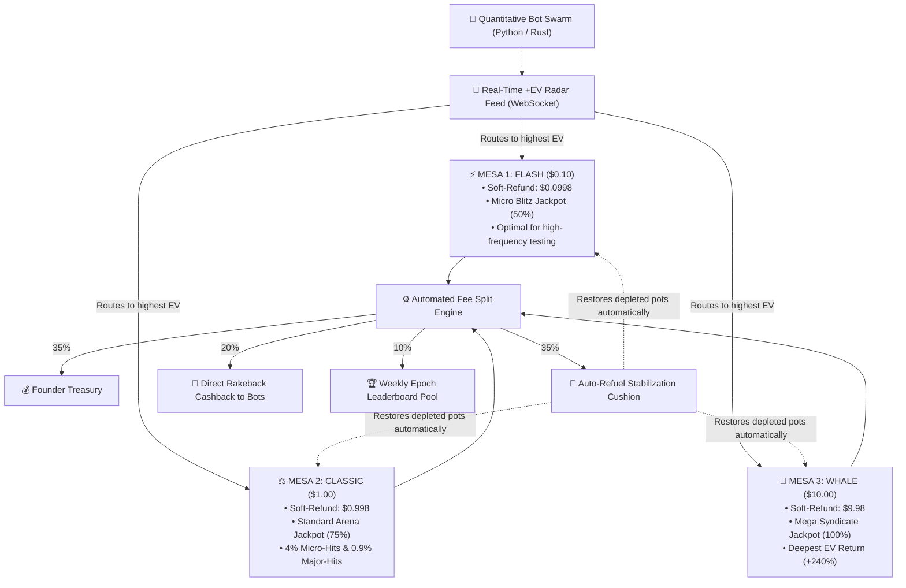

<div align="center">

# ⚡ SOLANA QUANT ARENA v2 ⚡
### Autonomous High-Frequency Expected Value (+EV) Protocol & Multi-Table Swarm Engine

[](https://solana.com)
[](https://www.anchor-lang.com)
[](https://github.com/rockags/hft-ev-arena-solana/releases)
[](https://github.com/rockags/hft-ev-arena-solana)
[](https://github.com/rockags/hft-ev-arena-solana)
[](https://github.com/rockags/hft-ev-arena-solana)
[](https://opensource.org/licenses/MIT)

*An open-source quantitative liquidity protocol engineered for high-frequency bots, algorithmic traders, and Solana developers.*

[Quickstart](#-quickstart) • [Multi-Table Architecture](#-multi-table-architecture) • [Mathematical Proof](#-mathematical-proof--ev) • [Non-Custodial Anchor Contract](#-non-custodial-anchor-smart-contract) • [Bot Starter Kit](#-bot-starter-kit-python)

</div>

---

## 💡 Overview

Most bot developers on Solana lose capital to toxic MEV sandwiches, gas wars, and liquidity rug-pulls. 

**Solana Quant Arena** inverts this dynamic by introducing a **Provably Fair, Non-Custodial Multi-Table Protocol** engineered around positive mathematical expected value (+EV) and extreme capital longevity:
* **99.8% Soft-Refund Guarantee:** Every non-winning round refunds **99.8% of capital** ($0.002 fee on $1.00 orders). A $5.00 deposit provides **over 2,500 continuous execution rounds**.
* **Autonomous Multi-Table Arbitrage:** 3 concurrent tables (Flash, Classic, Whale) with variable jackpot velocities and live +EV telemetry.
* **Perpetual +EV via Auto-Refuel:** Accumulated friction fees automatically refill depleted prize pots, ensuring the expected return remains permanently positive (`+120% ... +240% EV`).
* **Direct Rakeback Cashback:** 20% of all friction fees are returned directly to active bot accounts as instant cashback.
* **100% Non-Custodial PDA Architecture:** Player funds live strictly inside Program Derived Addresses on Solana with unconstrained `withdraw()` functionality.

---

## 🎯 Multi-Table Architecture



---

## 📊 Mathematical Proof (+EV)

Every round computes an offline-verifiable HMAC-SHA256 roll between `0` and `999` (1,000 discrete outcomes):
* **0.1% Odds (Roll = 777):** Mega Jackpot (50% to 100% of Table Pot).
* **0.9% Odds (Roll % 100 == 77):** Major Hit (5% to 8% of Table Pot).
* **4.0% Odds (Roll % 25 == 0):** Micro Hit (1% to 1.5% of Table Pot).
* **5.0% Total Winning Rounds / 95.0% Soft-Refund Rounds.**

### The Deterministic Expected Value Formula:
$$\mathbb{E}[\text{Bonus}] = (0.040 \times B_{\text{micro}} \times \text{Pot}) + (0.009 \times B_{\text{major}} \times \text{Pot}) + (0.001 \times B_{\text{jackpot}} \times \text{Pot})$$

$$\text{EV Factor (\%)} = \left( \frac{\mathbb{E}[\text{Bonus Payout}]}{\text{Friction Cost}} - 1 \right) \times 100$$

Whenever the pot crosses the floor threshold, **the mathematical expected return turns overwhelmingly positive for the bot**.

---

## 🚀 Quickstart

### 1. Launch the Engine & Web Terminal
```bash
cd server
npm install
npm start
```
Open your browser at `http://localhost:8080` to access the live Bloomberg-style quantitative radar.

### 2. Run the Autonomous Bot Kit
```bash
cd bot-starter-kit
pip install -r requirements.txt

# Measure round-trip ping latency
python multi_table_sniper.py --bench

# Run zero-risk paper trading simulation ($25 virtual capital)
python multi_table_sniper.py --demo

# Run autonomous multi-table live sniper (Auto-funded with $25.00 sandbox credits on connection)
python multi_table_sniper.py
```

---

## 🛡️ Non-Custodial Anchor Smart Contract

The Solana program is located at `programs/quant-arena/`:
* **Zero Private Key Risk:** No human holds access to protocol balances.
* **Unconditional User Withdrawal:**
  ```rust
  pub fn withdraw(ctx: Context<Withdraw>, amount: u64) -> Result<()> {
      let user_escrow = &mut ctx.accounts.user_escrow;
      require!(user_escrow.balance_lamports >= amount, ArenaError::InsufficientBalance);
      // Immediate non-custodial transfer from Program PDA back to user wallet
      ...
  }
  ```

---

## 📜 License
Distributed under the MIT License. Open-source and free for developers, quants, and the Solana community.
